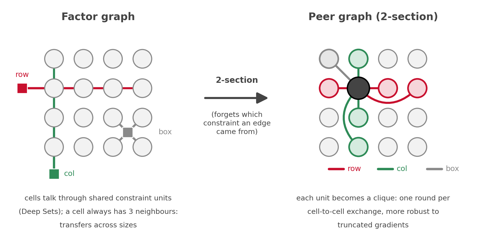
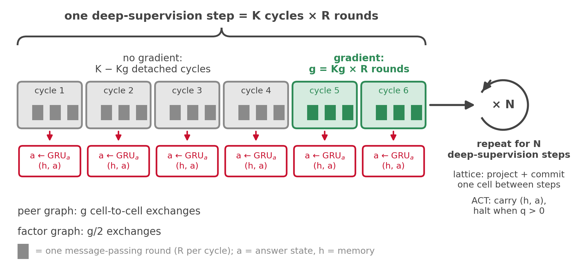

# Tiny Recursive Message Passing

Paper: *Tiny Recursive Message Passing*, Salvatori, Forasassi, Toumi, de Felice (Relational Intelligence, TU Wien); Small recursive graph networks (16k to 65k parameters) that solve Sudoku, mazes, N-Queens and SAT.

Tiny Recursive Message Passing (TRMP) runs typed message passing on the constraint graph of a puzzle and trains it with the machinery of tiny recursive models: deep supervision, truncated recursion, adaptive halting (ACT) and a deduction lattice. One shared cell is applied to every vertex of the graph, so the same weights solve boards of different sizes. With 32k parameters the ACT model solves 99.4% of Sudoku-Extreme in one deterministic pass and 100% with best-of-64, and the maze ACT model solves all 1,000 Maze-unique test mazes.

## Two wirings



*A 4x4 Sudoku as a factor graph (cells joined to row, column and box units) and as its peer graph, the 2-section in which cells talk to each other directly.*

On the factor graph a 9x9 board has 81 cells and 27 units, and every cell has three neighbours; one Deep Sets module is shared by all units. On the peer graph there are no units and every cell reads its 20 peers directly. The factor graph transfers across board sizes because its degree does not grow with the board. The peer graph is more robust when the gradient is truncated. Both are exactly equivariant to the automorphisms of the graph, and digit relabelling is handled by augmentation.

## Model and training



*One deep-supervision step: K cycles of R rounds, the first K-Kg cycles detached, a gradient window of g = Kg R rounds; the lattice model rebuilds its state between steps, the ACT model carries it.*

- **Cells** hold a memory h. Each round, every cell encodes each incoming message with an MLP on [h; m], takes the mean, and updates h with a GRU followed by LayerNorm. It sends W h to all neighbours.
- **Units** are Deep Sets without memory: a per-message map, a pool over the members, and an MLP on [message; pool].
- **Answer state** a is updated once per cycle by a second, smaller GRU. Every readout (symbol, keep, conflict, halt) is linear in a.
- **Deep supervision with truncation.** A step runs K cycles of R rounds. The first K-Kg cycles run without gradient; each of the remaining cycles is read out and supervised.
- **Lattice.** The state is a set of candidate symbols per cell. After each step, candidates with low keep probability are removed. If a cell is empty or the conflict head fires, the chain restarts. Otherwise one undecided cell is committed to a sampled symbol (keep, commit, restart, as in DPLL, with learned propagation). Many chains run in parallel at test time.
- **ACT.** The state is carried between steps. A halting head reads the answer state, combines the per-vertex scores with a smooth minimum, and decides when a board is finished. At test time, k noisy rollouts are run and the one the halting head ranks highest is returned (best-of-k).

The generic code (wirings, cells, recursion, lattice, ACT and their trainers) lives in [`discopy.neural`](https://discopy-next.readthedocs.io/en/latest/api/neural.html), pinned in `requirements.txt`. This repository holds what is specific to each dataset and the hand-written kernels.

## Results

A 16k-parameter N-Queens model trained on 10x10 boards solves 81% of 16x16 boards zero-shot, and a 65k-parameter lattice model solves 99.5% of easy and 76.1% of medium 3-SAT formulas.

| Experiment | Params | Train (`python -m … --out <dir>`) | Test result |
|---|---|---|---|
| Sudoku, lattice, peer graph | 32,763 | `sudoku.train_lattice` | 98.9 % |
| Sudoku, ACT | 32,784 | `sudoku.train_act` | 99.4 % in one pass, 100 % best-of-64 |
| Maze-unique, ACT | 60,720 | `maze.train_act` | 100 % |
| N-Queens, 10x10 to 11x11 / 13x13 / 16x16 | 15,985 | `queens.train_act` ¹ | 99.0 / 95.6 / 80.9 % |
| 3-SAT, lattice, easy / medium / medium to hard | 64,689 | `sat.train_lattice --family 3sat` ² | 99.5 / 76.1 / 29.5 % |

¹ zero-shot; test with `--sizes 11 12 13 14 15 16`. Unstable from run to run; the checkpoint is selected on the 10x10 test split.\
² `--difficulty medium` trains on 40-200 variables; test it with `--splits medium hard` for the zero-shot transfer to 200-300 variables.

## Install

```
pip install -r requirements.txt
```

Run everything from the repository root. Sudoku ACT uses CUDA kernels built on first use (H100, `nvcc`, `ninja`; cached in `$GNN_KERNEL_DIR`; plain PyTorch elsewhere). The maze trainers and `maze.eval_lattice` use a Triton round by default (`--kernel off` for plain PyTorch).

`--kernel geometric`, on every sudoku and maze script, runs the same network along the blocks of its symmetry group ([`discopy.neural.geometric`](https://discopy-next.readthedocs.io/en/latest/api/neural.html)): the same weights, names and checkpoints, the same function rounded differently, with no gather and no hand-written kernel. N-Queens has none: its diagonals are not blocks of a product of symmetric groups.

## Data

Each script reads `--data` and builds a missing dataset on first use. To build them up front:

```
export SUDOKU_DATA=data   # sudoku-extreme, pinned Hugging Face revision, SHA-256 checked
python -m sudoku.data
```

```
export MAZE_DATA=data     # maze-unique 30x30 from locuslab/EqR-data, written to $MAZE_DATA/maze
python -m maze.data
```

```
export QUEENS_DATA=data   # 10x10 pool and 11x11..16x16 probes; n16 takes minutes and several GB
python -m queens.data
```

```
export SAT_DATA=data      # G4SATBench's sr and 3-sat, its generators ported to sat.data
python -m sat.data --difficulty easy          # both families, minutes and 6 GB
python -m sat.data --difficulty medium hard   # hours and 17 GB
```

The 100 maze validation mazes ship in `maze/valid100.txt`. `sat.data` writes G4SATBench's own layout, so `--data` also accepts a tree its generators wrote.

## Layout

```
kernel/   dispatch.py autograd.py build.py packing.py *.cu *.cuh     # CUDA segment kernels of the sudoku peer graph
sudoku/   data.py train_lattice.py eval_lattice.py train_act.py eval_act.py
          geometric.py                                               # --kernel geometric
maze/     data.py valid100.txt graph.py model.py lattice.py solve.py act.py
          fast.py kernel.py geometric.py                             # fused round, Triton round, --kernel geometric
          train_lattice.py eval_lattice.py train_act.py eval_act.py
queens/   data.py model.py train_act.py eval_act.py
sat/      data.py model.py lattice.py solve.py act.py                # ragged CNF batches
          train_lattice.py eval_lattice.py train_act.py eval_act.py
parity/   golden.json runs.py step.py fingerprint.py test_*.py       # same bits, same function
bench.py                                                             # every backend, timed
```

Cells, units, recursion, lattice, ACT, the trainers and the geometric backend are in `discopy.neural`. The RRN baseline and RandCSPBench are not in this repository.

## Citation

```
@article{salvatori2026tiny,
  title={Tiny Recursive Message Passing},
  author={Salvatori, Tommaso and Forasassi, Matteo and Toumi, Alexis and de Felice, Giovanni},
  year={2026},
  note={arXiv preprint}
}
```
